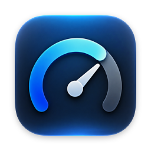
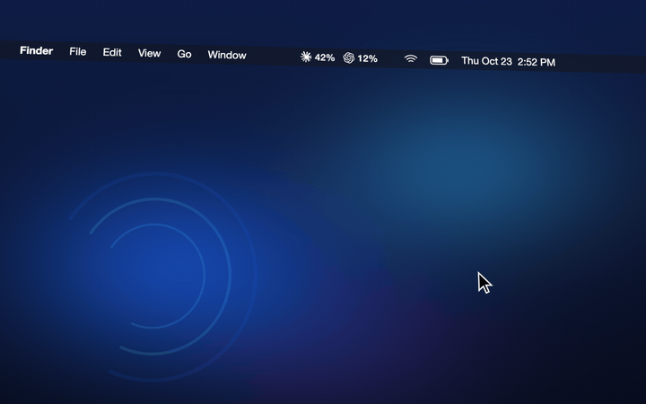

<p align="center">
  
</p>

<h1 align="center">TokenBar</h1>

<p align="center">
  <strong>Your AI usage limits, right in the macOS menu bar.</strong>
</p>

<p align="center">
  <a href="https://github.com/DerRafDev/tokenbar/releases/latest">Download</a> ·
  <a href="docs/providers.md">Providers</a> ·
  <a href="#privacy">Privacy</a>
  <br><br>
  <a href="https://github.com/DerRafDev/tokenbar/actions/workflows/ci.yml"></a>
  <a href="LICENSE"></a>
</p>

TokenBar shows how much of your Claude and Codex plan limits you have used, and when they
reset, without opening a terminal or a website. It is a small native Mac app that talks
directly to the providers. There is no TokenBar server and no account.

<p align="center">
  
  <br>
  <sub>Product demo with sample data (<a href="tools/demo">source</a>)</sub>
</p>

## Features

- **Glanceable menu bar.** Each provider's logo with its current session usage, the number
  that matters while you code. Prefer less? Show only the busiest one (Minimal), or
  session and week as `15/12` (Detailed).
- **Session and weekly limits.** The popover lists every provider in one line; click one
  to see each limit with a bar and its reset time.
- **Reset times you can read.** "Resets at 19:10 (in 2h 50m)", computed locally in your
  time zone.
- **Refreshes on its own.** Every 5 minutes by default (2–15 configurable), after the Mac
  wakes, and when you open the popover. Never polls aggressively.
- **Honest when data is old.** If a refresh fails, you keep the last values with an
  "outdated" mark instead of an error screen.
- **Opens at login**, if you want it to.
- **Updates itself when you ask** (from the first release after 0.1.0). Gear menu ›
  **Check for Updates…** installs a new version and relaunches TokenBar. It never checks
  on its own.
- **English and Portuguese (Brazil).**
- **Native and light.** SwiftUI and AppKit, no Electron. The only third-party code is
  [Sparkle](https://sparkle-project.org), the standard Mac framework for in-app updates.

## Supported providers

| Provider | Status | What it shows | Requires |
|---|---|---|---|
| **Claude** (Pro, Max) | Experimental | Current session (5 h) and weekly limits, plus Opus/Sonnet weekly limits when your plan has them | Claude Code signed in on this Mac |
| **Codex** (ChatGPT plans) | Experimental | Codex 5-hour and weekly limits, plus model-specific limits when your plan has them | Codex (CLI or app) signed in with ChatGPT on this Mac |

Codex limits are **not** ChatGPT chat message limits; TokenBar does not show those.

> [!IMPORTANT]
> **Both integrations are experimental.** Neither Anthropic nor OpenAI publishes an API for
> plan limits, so TokenBar uses the same undocumented endpoints that Claude Code and Codex
> use to show your usage. They may change or stop working at any time, and the providers'
> terms may not cover this use. TokenBar explains this before you enable each provider.
> Every detail is in [docs/providers.md](docs/providers.md).

## Installation

Requires macOS 14 Sonoma or later, on Apple silicon or Intel.

> [!WARNING]
> **TokenBar 0.1.0 is unsigned and not notarized by Apple.** Its files are named
> `TokenBar-0.1.0-unsigned.dmg` and `.zip`. macOS Gatekeeper will block the first launch.
> This does not mean macOS found malware: the build has not gone through Apple's
> Developer ID signing and notarization. Only open it if you downloaded it from the
> [official TokenBar releases](https://github.com/DerRafDev/tokenbar/releases) and you
> trust the project. You can also build it yourself from source (see [Development](#development)).

1. Download `TokenBar-<version>-unsigned.dmg` from the
   [latest release](https://github.com/DerRafDev/tokenbar/releases/latest).
2. Open the DMG.
3. Drag **TokenBar** to **Applications**.
4. Open TokenBar from Applications. macOS says it cannot verify the app; click **Done**
   (or **OK**).
5. Open **System Settings › Privacy & Security**.
6. Scroll to **Security**, find the message about TokenBar, and click **Open Anyway**.
7. Confirm with **Open Anyway** and your password or Touch ID.
8. TokenBar opens and lives in the menu bar; there is no Dock icon or window. Later
   launches open normally.

Then click the menu bar icon → **Configure Providers…**, and enable the providers you use.

This approves TokenBar only. Do not turn off Gatekeeper for your whole Mac.

Each release lists SHA-256 checksums in `SHA256SUMS.txt`
(`shasum -a 256 -c SHA256SUMS.txt`).

Because the build is unsigned, macOS may ask again for access to Claude Code's Keychain
item after you install an update. Signing and notarization are planned after 0.1.0
([roadmap](docs/roadmap.md)).

### Updating

> [!NOTE]
> In-app updates are not in a release yet. TokenBar 0.1.0 has no updater; the first
> release after 0.1.0 will be the first one that has it.

**Where it is:** click the TokenBar icon in the menu bar, then the **gear** button at the
bottom right of the popover, and choose **Check for Updates…** (**Buscar atualizações…**
in Portuguese), just above **Quit TokenBar**.

If a new version exists, TokenBar shows what changed. Click **Install Update** (**Instalar
Atualização**), then **Install and Relaunch** (**Instalar e Reabrir**). TokenBar quits,
installs the new version and opens again, with your preferences and enabled providers
kept. If you already have the latest version, it says so. TokenBar never checks on its
own; it only looks for updates when you choose this item.

**Coming from TokenBar 0.1.0?** 0.1.0 has no **Check for Updates…** and cannot update
itself. Install the first version with the updater by hand, once:

1. Quit TokenBar (gear menu › **Quit TokenBar**).
2. Download the new DMG from the [latest release](https://github.com/DerRafDev/tokenbar/releases/latest).
3. Open it and drag **TokenBar** to **Applications**, choosing **Replace**.
4. Open TokenBar. If that release is unsigned, approve it again with **Open Anyway** as in
   the installation steps above.

Your preferences and enabled providers are kept. From then on, every new version installs
from the gear menu.

Updates are verified before they are installed: each one is signed with the project's
EdDSA key, and TokenBar refuses an update whose signature does not match.

### Enabling a provider

Every provider starts **disabled**. TokenBar reads nothing until you enable one, and it
shows what will be read before you confirm.

- **Claude** reads Claude Code's sign-in from your Keychain and keeps it in memory while
  TokenBar runs. It reads it again only when Claude Code renews it or it expires, so macOS
  asks at most then; choose **Always Allow** so it does not ask at all. If you deny it,
  TokenBar stops asking until you refresh manually.
- **Codex** reads `~/.codex/auth.json` (or `$CODEX_HOME/auth.json`). Codex installations
  that keep their sign-in in the Keychain (`cli_auth_credentials_store = "keyring"`) are
  not supported yet.

If a sign-in expires, run Claude Code or Codex once and TokenBar picks up the renewed
sign-in on its next refresh. TokenBar never renews tokens or writes them to disk.

## Privacy

**Your usage data stays on your Mac.**

- TokenBar sends requests only to `api.anthropic.com` (Claude) and `chatgpt.com` (Codex),
  and only for the providers you enabled, plus GitHub when you check for updates.
- No analytics, telemetry, crash reporting, or tracking.
- Update checks happen only when you choose **Check for Updates…**. TokenBar then
  downloads the release feed from GitHub (`github.com` and its download servers), and
  the update itself if you install it. No information about you or your Mac is sent.
- No database or history: usage is kept in memory and never written to disk. Network
  responses are not cached and cookies are not stored.
- Sign-ins are read when a refresh needs them. TokenBar keeps the Claude Code token in
  memory only, never writes sign-ins to disk or refreshes them, and never logs tokens,
  account identifiers, or response bodies.
- Preferences (refresh interval, enabled providers, menu bar mode) are stored in the
  usual macOS preferences file.

## Development

Requirements: macOS 14+ and Xcode 26 or later.

```sh
git clone https://github.com/DerRafDev/tokenbar.git
cd tokenbar
open apps/macos/TokenBar.xcodeproj    # run the "TokenBar" scheme
```

From the repository root:

```sh
scripts/test.sh       # build and test TokenBarKit
scripts/format.sh     # format all Swift sources in place
scripts/lint.sh       # check formatting and lint rules (what CI runs)
scripts/release.sh    # build the DMG, ZIP and appcast into dist/ (see docs/releasing.md)
scripts/test-update.sh build   # local in-app update test (see docs/releasing.md)
```

Every build runs the real providers. To work on the UI without accounts, launch a Debug
build with `TOKENBAR_DEMO=1` (listed, unchecked, in the scheme's environment variables).
Demo data is labeled "Demo" and does not exist in Release builds.

### Experimental: Claude Code question alerts

Debug builds include a prototype that shows when a Claude Code session is waiting for your answer
to a question: `● Claude · 2` in the menu bar, an **Agents** page in the popover, and
**Go to Session** to bring the Terminal.app tab with the question to the front. It is off unless
you launch with `TOKENBAR_AGENT_HOOKS=1` (listed, unchecked, in the scheme) and set up Claude Code
hooks in a test folder by hand. It is not part of Release builds. To try it, follow
[docs/testing-agent-alerts.md](docs/testing-agent-alerts.md); design and limits are in
[docs/agents.md](docs/agents.md).

The repository also holds the TokenBar website in `apps/web`, a separate static site
with its own [README](apps/web/README.md). The app never needs it to build.

## Architecture

All logic lives in the `TokenBarKit` Swift package: `TokenBarCore` (domain model and
refresh), `TokenBarProviders` (Claude, Codex, networking, credentials), and `TokenBarUI`
(SwiftUI). The Xcode project is a thin shell that produces the `.app`. See
[docs/architecture.md](docs/architecture.md).

## Adding a provider

Each provider implements one protocol and returns a normalized `UsageSnapshot`. Document
the data source first, then follow [docs/adding-a-provider.md](docs/adding-a-provider.md).

## Contributing

Contributions are welcome. Read [CONTRIBUTING.md](CONTRIBUTING.md) first. What is planned
next is in [docs/roadmap.md](docs/roadmap.md).

## Security

Please report vulnerabilities privately. See [SECURITY.md](SECURITY.md).

## License

[MIT](LICENSE). TokenBar is not affiliated with Anthropic or OpenAI. Claude, ChatGPT,
and Codex, and the Claude and OpenAI logos, are trademarks of their respective owners.
TokenBar shows the logos only to identify each provider; they are not covered by the MIT
license.
