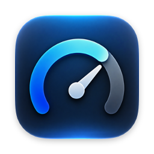
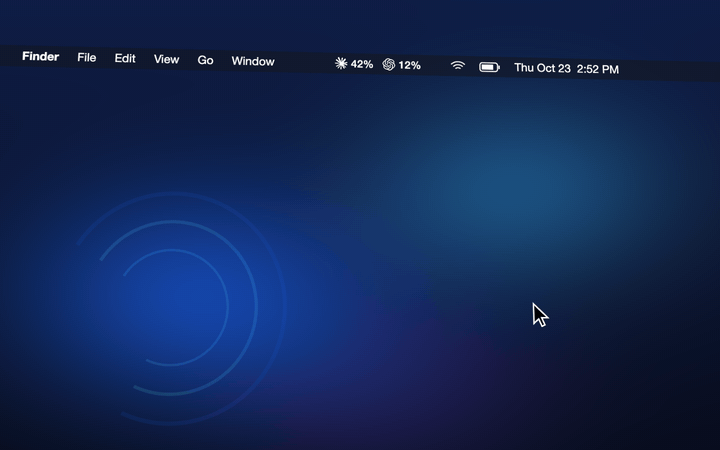

<p align="center">
  
</p>

<h1 align="center">TokenBar</h1>

<p align="center">
  <strong>Your AI usage limits, right in the macOS menu bar.</strong>
</p>

<p align="center">
  <a href="https://github.com/DerRafDev/tokenbar/releases/latest">Download</a> ·
  <a href="docs/providers.md">Providers</a> ·
  <a href="#privacy">Privacy</a>
  <br><br>
  <a href="https://github.com/DerRafDev/tokenbar/actions/workflows/ci.yml"></a>
  <a href="LICENSE"></a>
</p>

TokenBar shows how much of your Claude and Codex plan limits you have used, and when they
reset, without opening a terminal or a website. It is a small native Mac app that talks
directly to the providers. There is no TokenBar server and no account.

<p align="center">
  
</p>

## Features

- **Glanceable menu bar.** Each provider's logo with its current session usage, the number
  that matters while you code. Prefer less? Show only the busiest one (Minimal), or
  session and week as `15/12` (Detailed).
- **Session and weekly limits.** The popover lists every provider in one line; click one
  to see each limit with a bar and its reset time.
- **Reset times you can read.** "Resets at 19:10 (in 2h 50m)", computed locally in your
  time zone.
- **Refreshes on its own.** Every 5 minutes by default (2–15 configurable), after the Mac
  wakes, and when you open the popover. Never polls aggressively.
- **Honest when data is old.** If a refresh fails, you keep the last values with an
  "outdated" mark instead of an error screen.
- **Opens at login**, if you want it to.
- **English and Portuguese (Brazil).**
- **Native and light.** SwiftUI and AppKit, no Electron, no web views, no third-party code.

## Supported providers

| Provider | Status | What it shows | Requires |
|---|---|---|---|
| **Claude** (Pro, Max) | Experimental | Current session (5 h) and weekly limits, plus Opus/Sonnet weekly limits when your plan has them | Claude Code signed in on this Mac |
| **Codex** (ChatGPT plans) | Experimental | Codex 5-hour and weekly limits, plus model-specific limits when your plan has them | Codex (CLI or app) signed in with ChatGPT on this Mac |

Codex limits are **not** ChatGPT chat message limits; TokenBar does not show those.

> [!IMPORTANT]
> **Both integrations are experimental.** Neither Anthropic nor OpenAI publishes an API for
> plan limits, so TokenBar uses the same undocumented endpoints that Claude Code and Codex
> use to show your usage. They may change or stop working at any time, and the providers'
> terms may not cover this use. TokenBar explains this before you enable each provider.
> Every detail is in [docs/providers.md](docs/providers.md).

## Installation

Requires macOS 14 Sonoma or later, on Apple silicon or Intel.

1. Download `TokenBar-<version>.dmg` from the
   [latest release](https://github.com/DerRafDev/tokenbar/releases/latest).
2. Open it and drag **TokenBar** to **Applications**.
3. Open TokenBar. It lives in the menu bar; there is no Dock icon or window.
4. Click the menu bar icon → **Configure Providers…**, and enable the providers you use.

Each release lists SHA-256 checksums in `SHA256SUMS.txt`
(`shasum -a 256 -c SHA256SUMS.txt`).

If a release is marked **unsigned**, macOS blocks it on first launch. Open
**System Settings › Privacy & Security** and click **Open Anyway** next to TokenBar.

### Enabling a provider

Every provider starts **disabled**. TokenBar reads nothing until you enable one, and it
shows what will be read before you confirm.

- **Claude** reads Claude Code's sign-in from your Keychain on each refresh. macOS asks
  for permission the first time; choose **Always Allow** so it does not ask on every
  refresh. If you deny it, TokenBar stops asking until you refresh manually.
- **Codex** reads `~/.codex/auth.json` (or `$CODEX_HOME/auth.json`). Codex installations
  that keep their sign-in in the Keychain (`cli_auth_credentials_store = "keyring"`) are
  not supported yet.

If a sign-in expires, run Claude Code or Codex once and TokenBar picks up the renewed
sign-in on its next refresh. TokenBar never renews or copies tokens itself.

## Privacy

**Your usage data stays on your Mac.**

- TokenBar sends requests only to `api.anthropic.com` (Claude) and `chatgpt.com` (Codex),
  and only for the providers you enabled.
- No analytics, telemetry, crash reporting, tracking, or update checks.
- No database or history: usage is kept in memory and never written to disk. Network
  responses are not cached and cookies are not stored.
- Sign-ins are read when a refresh happens. TokenBar never stores, copies, or refreshes
  them, and never logs tokens, account identifiers, or response bodies.
- Preferences (refresh interval, enabled providers, menu bar mode) are stored in the
  usual macOS preferences file.

## Development

Requirements: macOS 14+ and Xcode 26 or later.

```sh
git clone https://github.com/DerRafDev/tokenbar.git
cd tokenbar
open apps/macos/TokenBar.xcodeproj    # run the "TokenBar" scheme
```

From the repository root:

```sh
scripts/test.sh       # build and test TokenBarKit
scripts/format.sh     # format all Swift sources in place
scripts/lint.sh       # check formatting and lint rules (what CI runs)
scripts/release.sh    # build the DMG and ZIP into dist/ (see docs/releasing.md)
```

Every build runs the real providers. To work on the UI without accounts, launch a Debug
build with `TOKENBAR_DEMO=1` (listed, unchecked, in the scheme's environment variables).
Demo data is labeled "Demo" and does not exist in Release builds.

## Architecture

All logic lives in the `TokenBarKit` Swift package: `TokenBarCore` (domain model and
refresh), `TokenBarProviders` (Claude, Codex, networking, credentials), and `TokenBarUI`
(SwiftUI). The Xcode project is a thin shell that produces the `.app`. See
[docs/architecture.md](docs/architecture.md).

## Adding a provider

Each provider implements one protocol and returns a normalized `UsageSnapshot`. Document
the data source first, then follow [docs/adding-a-provider.md](docs/adding-a-provider.md).

## Contributing

Contributions are welcome. Read [CONTRIBUTING.md](CONTRIBUTING.md) first. What is planned
next is in [docs/roadmap.md](docs/roadmap.md).

## Security

Please report vulnerabilities privately. See [SECURITY.md](SECURITY.md).

## License

[MIT](LICENSE). TokenBar is not affiliated with Anthropic or OpenAI. Claude, ChatGPT,
and Codex, and the Claude and OpenAI logos, are trademarks of their respective owners.
TokenBar shows the logos only to identify each provider; they are not covered by the MIT
license.
