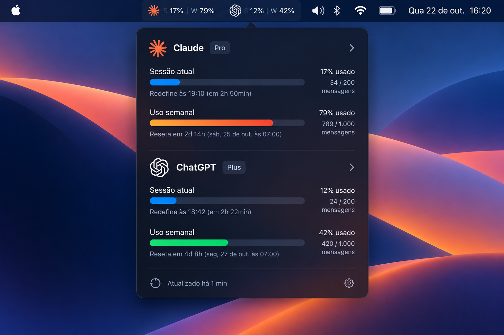

# TokenBar

> Native macOS menu bar app to track your AI usage limits and resets.

[](https://github.com/DerRafDev/tokenbar/actions/workflows/ci.yml)


[](LICENSE)

<p align="center">
  
  <br>
  <sub>Design mockup. TokenBar is in early development.</sub>
</p>

## Features

- **Glanceable menu bar summary.** `S 17% | W 79%` per provider, where **S** is the
  current session and **W** is the weekly limit.
- **Reset times you can read.** "Resets at 19:10 (in 2h 50min)", computed locally in
  your time zone.
- **Native and light.** SwiftUI + AppKit, no Electron, no web views, no third-party
  dependencies. Refreshes every few minutes, never polls aggressively.
- **Private by design.** Usage data stays on your Mac. TokenBar talks directly to
  the providers. There is no TokenBar server.
- **Stale data instead of error screens.** If a refresh fails, you keep the last
  known values with a clear "outdated" marker.

## Supported providers

| Provider | Status | What is shown | Requires |
|---|---|---|---|
| Claude (Pro/Max) | Experimental, opt-in | Session (5 h), weekly, and model-specific weekly limits | Claude Code signed in |
| Codex (ChatGPT plans) | Experimental, opt-in | Codex 5-hour session and weekly limits on your plan, plus model-specific limits when the plan has them. **Not** ChatGPT chat message limits. | Codex signed in with ChatGPT |

Neither Anthropic nor OpenAI publishes an API for subscription limits. Read
[docs/providers.md](docs/providers.md) for exactly where the data comes from and
what its limitations are.

## Installation

No release yet. Follow [Development](#development) to build from source.

## Development

Requirements: macOS 14+, Xcode 16 or later.

```sh
git clone https://github.com/DerRafDev/tokenbar.git
cd tokenbar
open apps/macos/TokenBar.xcodeproj    # run the "TokenBar" scheme
```

Day-to-day commands, from the repository root:

```sh
scripts/test.sh       # build and test TokenBarKit
scripts/format.sh     # format all Swift sources in place
scripts/lint.sh       # check formatting and lint rules (what CI runs)
```

Debug builds include mock providers so the UI can be developed without accounts.
Release builds never contain them.

## Architecture

All logic lives in the `TokenBarKit` Swift package, with three modules: domain,
providers, and UI. The Xcode project is a thin shell that produces the `.app`
bundle. See [docs/architecture.md](docs/architecture.md).

## Adding a provider

Each provider implements one protocol and returns a normalized `UsageSnapshot`.
See [docs/adding-a-provider.md](docs/adding-a-provider.md).

## Contributing

Contributions are welcome. Read [CONTRIBUTING.md](CONTRIBUTING.md) first.

## Security

Please report vulnerabilities privately. See [SECURITY.md](SECURITY.md).

## License

[MIT](LICENSE). TokenBar is not affiliated with Anthropic or OpenAI. Claude, ChatGPT,
and Codex are trademarks of their respective owners.
